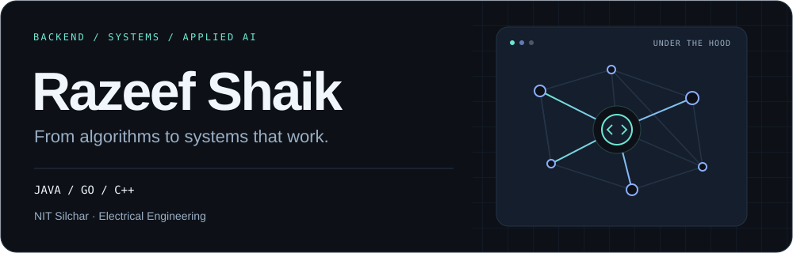

<picture>
  <source media="(prefers-color-scheme: dark)" srcset="./assets/header-dark.svg">
  <source media="(prefers-color-scheme: light)" srcset="./assets/header-light.svg">
  
</picture>

  <a href="https://www.linkedin.com/in/shaik-mahammad-razeef-374a4b2a4/"><b>LinkedIn</b></a> &nbsp;·&nbsp;
  <a href="mailto:shaikrazeef2@gmail.com"><b>Email</b></a> &nbsp;·&nbsp;
  <a href="https://leetcode.com/u/RAZEEF_SHAIK/"><b>LeetCode</b></a> &nbsp;·&nbsp;
  <a href="https://codeforces.com/profile/Razeef"><b>Codeforces</b></a>

I'm **Razeef**, an Electrical Engineering undergraduate at **NIT Silchar, class of 2027**, building backends, distributed search systems, and tools that put AI to work.

My work spans **Java / Spring Boot**, **Go**, and **C++** — from role-based applications used by real teams to a vector search engine built from scratch. I enjoy the details that make systems dependable: concurrency, recovery, tenant isolation, and clear API contracts.

### Selected builds

<table>
<tr>
<td width="50%" valign="top">
<h3><a href="https://github.com/Razeefshaik/VectorSearchEngine">01 · VectorSearchEngine</a></h3>

<b>From the index to the distributed system.</b>

A C++ HNSW core with SIMD distance kernels, Go bindings, and a four-shard cluster. Includes scatter-gather search, write-ahead logging, snapshot recovery, and tenant-scoped retrieval.

<code>C++</code> <code>Go</code> <code>gRPC</code> <code>HNSW</code>

<a href="https://github.com/Razeefshaik/VectorSearchEngine/blob/master/ARCHITECTURE.md">Explore the architecture →</a>
</td>
<td width="50%" valign="top">
<h3><a href="https://github.com/Razeefshaik/GoEgg">02 · GoEgg</a></h3>

<b>Equality saturation, written in Go.</b>

An e-graph library for rewriting expressions and extracting lower-cost equivalents. Implements union-find, hashconsing, and parallel matching, rebuilding, and extraction with goroutines.

<code>Go</code> <code>Algorithms</code> <code>Concurrency</code>

<a href="https://github.com/Razeefshaik/GoEgg#quick-start">Try the library →</a>
</td>
</tr>
<tr>
<td width="50%" valign="top">
<h3><a href="https://github.com/Razeefshaik/FixHub-Code-debugger-AI">03 · Code Guardian</a></h3>

<b>Repository-aware AI debugging.</b>

Spring Boot ingestion and worker services connected through Kafka. Retrieves related source code through my vector search stack, uses LLMs to propose fixes, and commits them to reviewable Git branches.

<code>Java</code> <code>Spring Boot</code> <code>Kafka</code> <code>RAG</code>

<a href="https://github.com/Razeefshaik/FixHub-Code-debugger-AI#-architecture">Follow the workflow →</a>
</td>
<td width="50%" valign="top">
<h3><a href="https://github.com/Razeefshaik/vectorsearch-gateway">04 · Vector Search Gateway</a></h3>

<b>Text in. Semantic search out.</b>

A Go gRPC gateway with Kafka ingestion, idempotent consumers, and per-client token-bucket rate limiting. Separate Python embedding services handle search and ingestion workloads.

<code>Go</code> <code>Python</code> <code>gRPC</code> <code>Kafka</code>

<a href="https://github.com/Razeefshaik/vectorsearch-gateway/blob/master/docs/ARCHITECTURE.md">Read the system design →</a>
</td>
</tr>
<tr>
<td width="50%" valign="top">
<h3><a href="https://github.com/Razeefshaik/LimaBackend">05 · LIMA</a></h3>

<b>Software for real operational workflows.</b>

A leave and health management application with a Spring Boot backend and Flutter client. Models hierarchical approvals, JWT authentication, role-based access, reporting, and notifications.

<code>Spring Boot</code> <code>PostgreSQL</code> <code>Flutter</code>

<a href="https://github.com/Razeefshaik/LimaBackend">Backend →</a> &nbsp;·&nbsp; <a href="https://github.com/Razeefshaik/limaFrontend">Mobile app →</a>
</td>
<td width="50%" valign="top">
<h3><a href="https://github.com/Razeefshaik/GoEV">06 · GoEV</a></h3>

<b>Electrical engineering meets backend systems.</b>

An EV-to-charging-station routing project combining MQTT telemetry, Redis live state, graph-based routing, greedy and batch assignment policies, and a real-time dashboard.

<code>Java</code> <code>Spring Boot</code> <code>Redis</code> <code>MQTT</code>

<a href="https://github.com/Razeefshaik/GoEV/blob/master/docs/ev-evcs-architecture-design.md">See the design →</a>
</td>
</tr>
</table>

### What I work with

| Area | Tools & concepts |
| :--- | :--- |
| **Languages** | Java · Go · C++ · Python · SQL |
| **Backend & APIs** | Spring Boot · Spring Security · REST · gRPC · OAuth2 · JWT · RBAC |
| **Data & infrastructure** | PostgreSQL · MySQL · Redis · Apache Kafka · Docker · Git |
| **Systems** | Sharding · WAL & recovery · Concurrency · Idempotency · Rate limiting |
| **Applied AI** | RAG · Vector search · HNSW · Embeddings · Spring AI · LangChain |
| **Also built with** | Flutter / Dart · Kotlin · Firebase · Taichi |

### Experience & research

**Research Intern · S.N. Bose National Centre for Basic Sciences**  
May – July 2026

Designed and implemented a GPU algorithm for discrete Voronoi diagrams using Python and the Taichi DSL. Worked on density-based cut-off heuristics and benchmarked performance against the Jump Flood Algorithm.

**Backend Software Developer Intern · LIMA, Defense Sector Organization**  
July – December 2025

Built a Java / Spring Boot backend serving **700+ personnel**, with PostgreSQL data models, JWT authentication, and multi-level access control. Received a **Certificate of Appreciation** from senior leadership.

**Moderator · Google Developer Student Clubs, NIT Silchar**  
September 2024 – May 2026

Delivered technical workshops for **30+ students** and helped explain software and systems concepts through community learning.

### Competitive programming

<table>
<tr>
<td align="center" width="33%">
<h3>1633</h3>
<a href="https://codeforces.com/profile/Razeef"><b>Codeforces · Expert</b></a> 
Peak rating
</td>
<td align="center" width="33%">
<h3>2032</h3>
<a href="https://leetcode.com/u/RAZEEF_SHAIK/"><b>LeetCode · Knight</b></a> 
Peak rating
</td>
<td align="center" width="33%">
<h3>1500+</h3>
<b>Problems solved</b> 
Across coding platforms
</td>
</tr>
</table>

<b>More problem-solving milestones</b>

- **AtCoder:** Cyan / 4 Kyu, peak rating **1255**.
- **CodeChef:** 3 Star, peak rating **1723**.

### What I'm exploring

- **Backend reliability:** failure handling, durable workflows, and concurrency.
- **Search infrastructure:** retrieval quality, tenant isolation, and observability.
- **Algorithms & research:** parallel computation and the trade-offs behind fast systems.

---

  <b>Let's talk backends, systems, or an interesting problem.</b> 
  <a href="mailto:shaikrazeef2@gmail.com">shaikrazeef2@gmail.com</a>

