

  

  

  
  
  
  

  <b>NIT Silchar · Electrical Engineering · Class of 2027</b> 
  Backend developer, systems builder, and algorithm enthusiast.

I build across **Java / Spring Boot, Go, and C++** — from applications used by real teams to the search infrastructure behind AI tools. I'm especially interested in **concurrency, recovery, tenant isolation, and the engineering behind reliable APIs**.

<h2 align="center">Featured engineering</h2>

From algorithms and storage engines to applications people use. Select a card to explore the code.

  <a href="https://github.com/Razeefshaik/VectorSearchEngine"></a>
  <a href="https://github.com/Razeefshaik/GoEgg"></a>

  <a href="https://github.com/Razeefshaik/FixHub-Code-debugger-AI"></a>
  <a href="https://github.com/Razeefshaik/vectorsearch-gateway"></a>

  <a href="https://github.com/Razeefshaik/LimaBackend"></a>
  <a href="https://github.com/Razeefshaik/GoEV"></a>

<b>Project map · architecture, source code &amp; implementation details</b>

| Project | Engineering focus | Explore |
| :--- | :--- | :--- |
| **Vector Search Engine** | HNSW in C++, Go bindings, four-shard scatter-gather search, WAL and snapshot recovery. | [Architecture](https://github.com/Razeefshaik/VectorSearchEngine/blob/master/ARCHITECTURE.md) |
| **GoEgg** | Union-find, hashconsing, and parallel e-graph matching, rebuilding, and extraction. | [Quick start](https://github.com/Razeefshaik/GoEgg#quick-start) |
| **Code Guardian** | Spring Boot ingestion and workers, Kafka jobs, repository-aware RAG, reviewable Git branches. | [Source & workflow](https://github.com/Razeefshaik/FixHub-Code-debugger-AI) |
| **Search Gateway** | Go gRPC APIs, idempotent Kafka consumers, token-bucket limits, separate search/ingest embedding services. | [System design](https://github.com/Razeefshaik/vectorsearch-gateway/blob/master/docs/ARCHITECTURE.md) |
| **LIMA** | Hierarchical leave approvals, JWT/RBAC, health reporting, PostgreSQL and Flutter. | [Backend](https://github.com/Razeefshaik/LimaBackend) · [Mobile](https://github.com/Razeefshaik/limaFrontend) |
| **GoEV** | MQTT telemetry, Redis live state, graph-based routing, greedy/batch assignment, real-time dashboard. | [Design](https://github.com/Razeefshaik/GoEV/blob/master/docs/ev-evcs-architecture-design.md) |

<h2 align="center">Tools of the trade</h2>

  
  
  
  
  
  

  
  
  
  
  
  

  <b>APIs &amp; messaging</b> &nbsp; REST · gRPC · Kafka · MQTT 
  <b>Security &amp; data</b> &nbsp; Spring Security · OAuth2 · JWT · RBAC · SQL 
  <b>AI &amp; retrieval</b> &nbsp; RAG · HNSW · Embeddings · Spring AI · LangChain 
  <b>Systems</b> &nbsp; Sharding · WAL · Recovery · Idempotency · Rate limiting

<h2 align="center">Experience with impact</h2>

**Research Intern · S.N. Bose National Centre for Basic Sciences**  
*May – July 2026*

Designed and implemented a GPU algorithm for discrete Voronoi diagrams using **Python and Taichi**. Worked on density-based cut-off heuristics and benchmarked performance against the Jump Flood Algorithm.

**Backend Software Developer Intern · LIMA, Defense Sector Organization**  
*July – December 2025*

Built a **Java / Spring Boot backend serving 700+ personnel**, with PostgreSQL data models, JWT authentication, and multi-level access control. Received a **Certificate of Appreciation** from senior leadership.

**Moderator · Google Developer Student Clubs, NIT Silchar**  
*September 2024 – May 2026*

Delivered **technical workshops for 30+ students**, sharing software and systems concepts through community learning.

<h2 align="center">Problem solving, practiced</h2>

  <a href="https://codeforces.com/profile/Razeef"></a>
  <a href="https://leetcode.com/u/RAZEEF_SHAIK/"></a>
  

  <b>Also:</b> AtCoder Cyan / 4 Kyu — peak 1255 &nbsp;·&nbsp; CodeChef 3 Star — peak 1723

<h2 align="center">Currently exploring</h2>

- **Backend reliability:** durable workflows, failure handling, and concurrency.
- **Search infrastructure:** retrieval quality, tenant isolation, and observability.
- **Algorithms & research:** parallel computation and the trade-offs behind fast systems.

  

  <b>Have an interesting backend, systems, or research problem?</b> 
  <a href="mailto:shaikrazeef2@gmail.com">Let's connect →</a>

